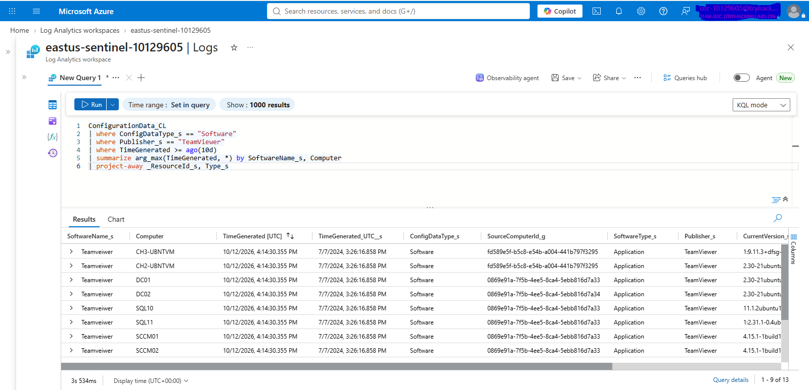
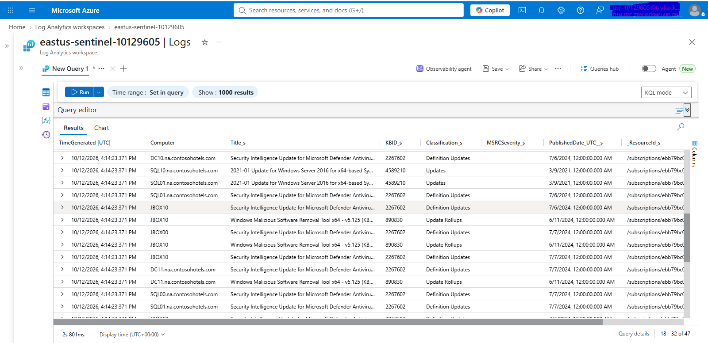

# KQL — Endpoint Investigation

## Objective

Use KQL to investigate endpoint activity, identify Azure virtual machines with TeamViewer installed, export the affected machine inventory, identify pending required updates, and provide remediation recommendations to the update management team.

## Data Sources

```text
ConfigurationData_CL
Update_CL
```

## 1. Identify Machines with TeamViewer Installed

Query the software inventory table to identify machines reporting TeamViewer installations within the last 10 days.

```kql
ConfigurationData_CL
| where ConfigDataType_s == "Software"
| where Publisher_s == "TeamViewer"
| where TimeGenerated >= ago(10d)
| summarize arg_max(TimeGenerated, *) by SoftwareName_s, Computer
| project-away _ResourceId_s, Type_s
```

Review the returned software records and identify the affected computers.



---

## 2. Identify Machines Requiring Updates

Query the update inventory to identify non-Linux machines with required, non-optional updates reported within the last 10 days.

```kql
Update_CL
| where OSType_s != "Linux" and UpdateState_s == "Needed" and Optional_s == "FALSE"
| where TimeGenerated >= ago(10d)
| project TimeGenerated, Computer, Title_s, KBID_s, Classification_s, MSRCSeverity_s, PublishedDate_UTC__s, _ResourceId_s
| sort by TimeGenerated desc
```

Review the computer name, update title, KB identifier, classification, and severity to support patch-management prioritization.



---

## 3. Correlate Software and Update Findings

Compare the computers identified in the TeamViewer inventory with those appearing in the pending-update results.

Use the exported CSV files to identify machines that appear in both reports and prioritize follow-up based on unauthorized software presence and outstanding required updates.

This comparison supports remediation planning; it does not establish that TeamViewer itself caused a security incident.

---

## 4. Export Investigation Results

Export each query's results from the Log Analytics interface.

```text
Log Analytics
→ Run query
→ Share or Export
→ Export to CSV
```

Maintain separate exports for:

- Computers reporting TeamViewer installations
- Computers reporting required, non-optional updates

Provide the TeamViewer inventory to the responsible device or server management team and the update report to the update management team.

---

## 5. Remediation Recommendations

### Unauthorized Software

- Request removal of TeamViewer from affected machines.
- Re-query the software inventory after remediation to verify the reported installation status.

### Pending Updates

- Ask the update management team to assess and prioritize the outstanding updates.
- Schedule patching according to severity, applicability, and organizational policy.
- Re-run the update query to verify the reported update status.

### Ongoing Monitoring

Save the queries for recurring software inventory and update assessments. Consider creating a workspace function for frequently reused query logic where supported.

---

## 6. Investigation

Review the query results and document:

- Machines reporting TeamViewer installations
- Machines reporting required updates
- Computers appearing in both result sets
- Relevant update classifications and severity values
- Export and handoff status
- Remediation recommendations
- Follow-up validation results

Sensitive environment-specific values should be omitted or replaced with placeholders in public documentation.

## Validation

- [ ] Software inventory queried
- [ ] TeamViewer installations identified
- [ ] Pending updates identified
- [ ] Results exported to CSV
- [ ] Software and update findings compared
- [ ] Remediation recommendations documented
- [ ] Follow-up validation approach defined

## Result

KQL was used to identify machines reporting TeamViewer installations and non-Linux machines reporting required, non-optional updates within the last 10 days. The resulting inventories support software-removal coordination, patch prioritization, and follow-up validation.

> **Portfolio note:** Remove or blur sensitive usernames, hostnames, IP addresses, tenant details, and other environment-specific identifiers before publishing screenshots.
