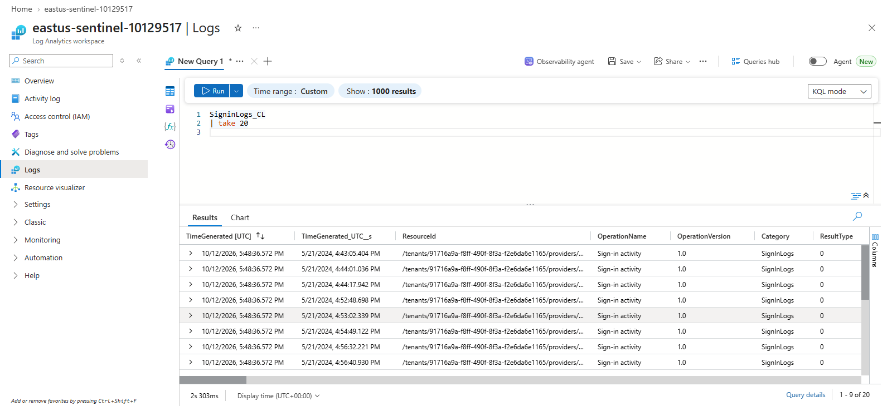
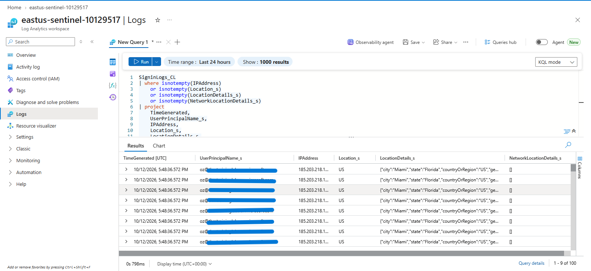
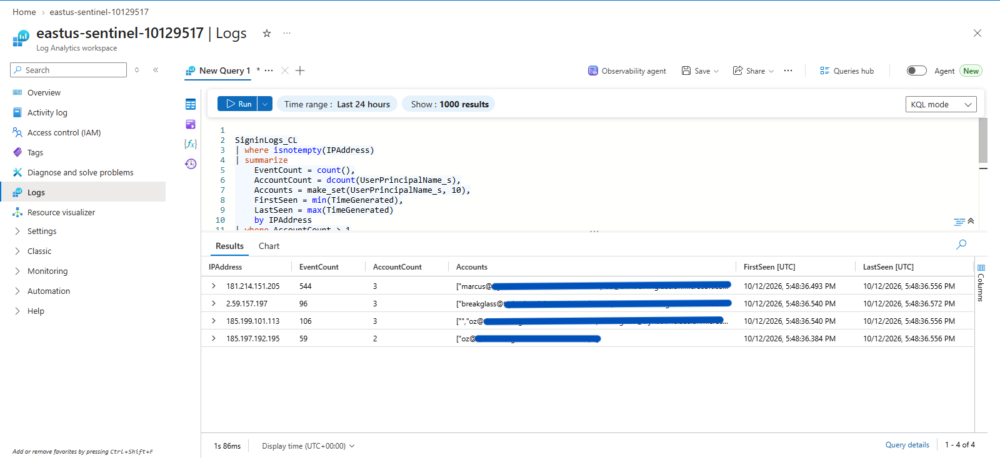
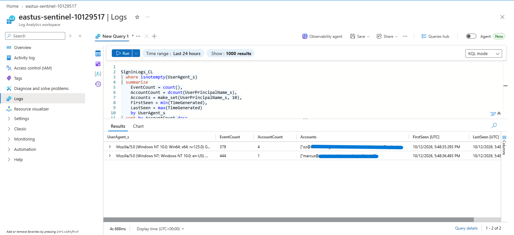
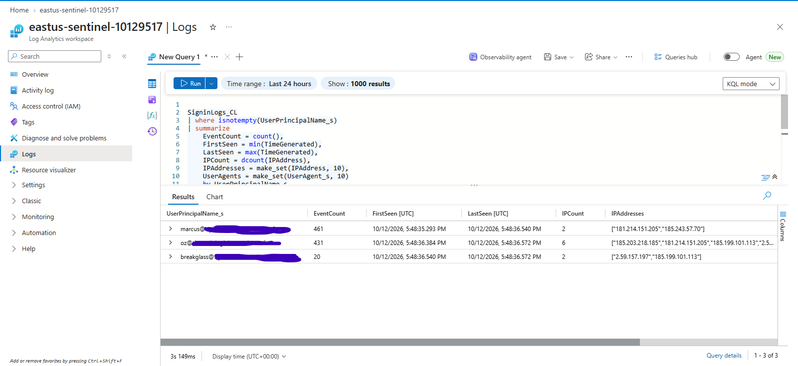

# KQL — Identity Investigation

## Objective

Use Kusto Query Language (KQL) to investigate user sign-in activity, location information, shared IP addresses, user-agent patterns across accounts, and observed account activity windows.

## Data Sources

The primary data source used in this investigation is:

```text
SigninLogs_CL
```

The workspace uses a custom table rather than the standard `SigninLogs` table. Use the tables available in the connected Microsoft Sentinel or Defender environment.

---

## 1. Review User Sign-In Activity

```kql
SigninLogs_CL
| take 20
```

Review recent identity records to establish which accounts appear in the available telemetry, when records were generated, and which user agents and token issuers are associated with the activity.

This provides the baseline for the subsequent investigations.



---

## 2. Investigate User Location Details

```kql
SigninLogs_CL
| where isnotempty(IPAddress)
    or isnotempty(Location_s)
    or isnotempty(LocationDetails_s)
    or isnotempty(NetworkLocationDetails_s)
| project
    TimeGenerated,
    UserPrincipalName_s,
    IPAddress,
    Location_s,
    LocationDetails_s,
    NetworkLocationDetails_s,
    IPAddressFromResourceProvider_s
| sort by TimeGenerated desc
| take 100
```

Review the available IP address and location fields associated with identity records.

Use this information to identify location patterns that may require verification against expected user activity. Location information can be incomplete or approximate, and a location difference alone does not establish malicious activity.



---

## 3. Identify IP Addresses Associated with Multiple Accounts

```kql
SigninLogs_CL
| where isnotempty(IPAddress)
| summarize
    EventCount = count(),
    AccountCount = dcount(UserPrincipalName_s),
    Accounts = make_set(UserPrincipalName_s, 10),
    FirstSeen = min(TimeGenerated),
    LastSeen = max(TimeGenerated)
    by IPAddress
| where AccountCount > 1
| sort by AccountCount desc
```

Identify IP addresses associated with multiple distinct user accounts in the available records.

Review the number of accounts, event volume, and observed time window for each IP address. Shared addresses may represent corporate networks, VPNs, proxies, or other legitimate shared infrastructure. Investigate unexpected patterns rather than treating shared IP usage as proof of compromise.



---

## 4. Investigate User-Agent Activity Across Accounts

```kql
SigninLogs_CL
| where isnotempty(UserAgent_s)
| summarize
    EventCount = count(),
    AccountCount = dcount(UserPrincipalName_s),
    Accounts = make_set(UserPrincipalName_s, 10),
    FirstSeen = min(TimeGenerated),
    LastSeen = max(TimeGenerated)
    by UserAgent_s
| sort by AccountCount desc
| take 30
```

Examine user-agent strings associated with multiple accounts. User-agent values can provide clues about the software or client environment represented in the telemetry.

Investigate unexpected user-agent patterns, especially when considered alongside IP addresses, account activity, and timestamps. User-agent strings can be shared, modified, or spoofed, so they should not be used as a standalone indicator of malicious activity.



---

## 5. Establish Each Account's Observed Activity Window

```kql
SigninLogs_CL
| where isnotempty(UserPrincipalName_s)
| summarize
    EventCount = count(),
    FirstSeen = min(TimeGenerated),
    LastSeen = max(TimeGenerated),
    IPCount = dcount(IPAddress),
    IPAddresses = make_set(IPAddress, 10),
    UserAgents = make_set(UserAgent_s, 10)
    by UserPrincipalName_s
| sort by EventCount desc
```

Establish the earliest and latest observed timestamps for each account in the available dataset. Review event counts, distinct IP addresses, and observed user-agent values to understand the recorded activity patterns.

The activity window represents the records available in the workspace, not necessarily the account's complete sign-in history. The first and last timestamps depend on the available telemetry and selected query time range.



---

## Investigation Workflow

The investigation followed this sequence:

1. Review available user sign-in activity.
2. Examine associated IP addresses and location details.
3. Identify IP addresses associated with multiple accounts.
4. Review user-agent patterns across accounts.
5. Establish the observed activity window for each account.

Correlate findings across these queries before deciding whether activity requires further investigation or escalation. Where available, validate findings against expected user behavior, approved network infrastructure, and additional security telemetry.

## Validation

- [x] User sign-in activity reviewed.
- [x] User location details reviewed.
- [x] Shared IP address patterns investigated.
- [x] User-agent activity across accounts investigated.
- [x] Observed account activity windows established.
- [ ] Findings validated against expected activity and supporting evidence.
- [ ] Potentially suspicious patterns documented for follow-up.

## Result

KQL was used to examine identity telemetry in the custom `SigninLogs_CL` table. The investigation established a baseline of observed sign-in activity and examined location details, IP addresses shared across accounts, user-agent patterns, and account activity windows.

These investigations support initial identity threat hunting and provide leads for further analysis. The available fields do not independently confirm successful authentication, account compromise, or malicious intent.

