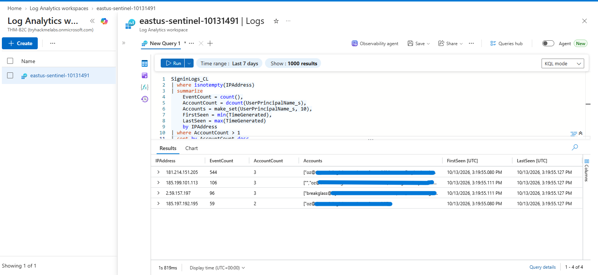
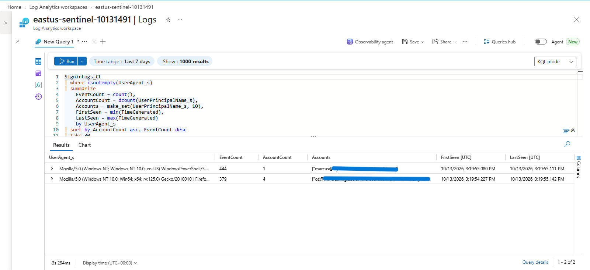
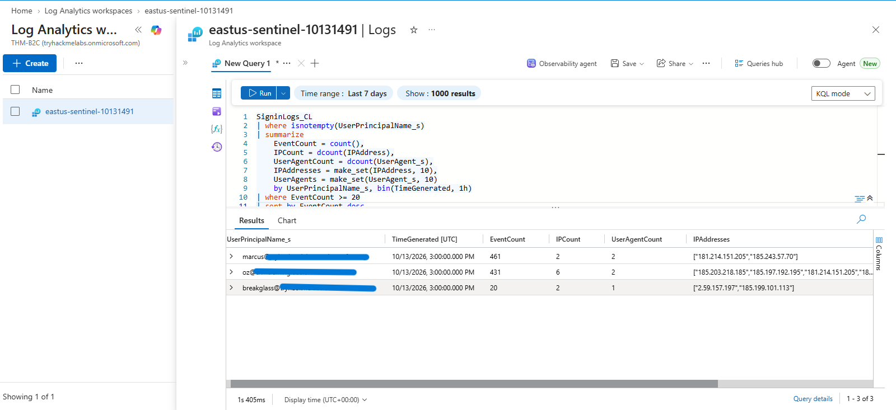
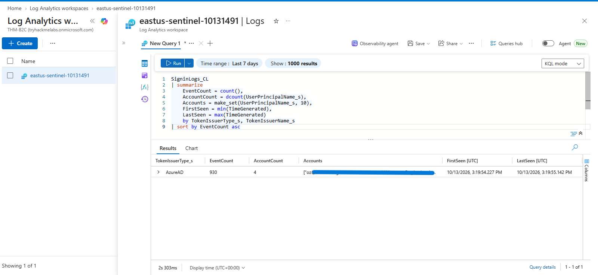
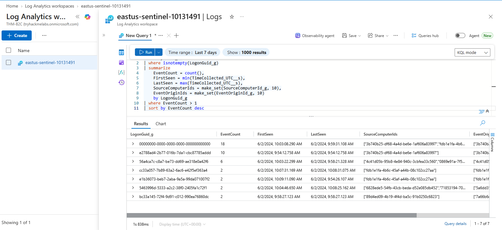

# KQL — Threat Hunting Investigation

## Objective

Use Kusto Query Language (KQL) to proactively carry out threat hunting activities, identigy unusual account behavior, shared source IP addresses, user-agent patterns, and security event activity within the available Azure Log Analytics telemetry.

The investigation focuses on identifying patterns that warrant further review. Query results are leads for investigation, not necessarily a confirmation of malicious activity.

## Data Sources

The following workspace tables are used:

```text
SigninLogs_CL
SecurityEvent_CL
```

---

## 1. Hunt for IP Addresses Associated with Multiple Accounts

```kql
SigninLogs_CL
| where isnotempty(IPAddress)
| summarize
    EventCount = count(),
    AccountCount = dcount(UserPrincipalName_s),
    Accounts = make_set(UserPrincipalName_s, 10),
    FirstSeen = min(TimeGenerated),
    LastSeen = max(TimeGenerated)
    by IPAddress
| where AccountCount > 1
| sort by AccountCount desc
```

Identify source IP addresses associated with multiple accounts in the available records.

Review the number of accounts, event volume, and observed time window for each IP address. Investigate unexpected patterns rather than treating shared IP usage as proof of compromise.



---

## 2. Hunt for Unusual User-Agent Patterns

```kql
SigninLogs_CL
| where isnotempty(UserAgent_s)
| summarize
    EventCount = count(),
    AccountCount = dcount(UserPrincipalName_s),
    Accounts = make_set(UserPrincipalName_s, 10),
    FirstSeen = min(TimeGenerated),
    LastSeen = max(TimeGenerated)
    by UserAgent_s
| sort by AccountCount asc, EventCount desc
| take 30
```

Review user-agent strings associated with relatively few accounts and identify patterns that may warrant further investigation.



---

## 3. Hunt for Unusually High Account Activity

```kql
SigninLogs_CL
| where isnotempty(UserPrincipalName_s)
| summarize
    EventCount = count(),
    IPCount = dcount(IPAddress),
    UserAgentCount = dcount(UserAgent_s),
    IPAddresses = make_set(IPAddress, 10),
    UserAgents = make_set(UserAgent_s, 10)
    by UserPrincipalName_s, bin(TimeGenerated, 1h)
| where EventCount >= 20
| sort by EventCount desc
```

Identify account-hour combinations with at least 20 records in the available identity telemetry.

Review high-volume periods alongside IP address and user-agent diversity. Adjust the threshold after establishing a baseline for normal activity. The query counts records; it does not establish that every record represents a distinct authentication attempt.



---

## 4. Hunt for Unusual Token Issuer Patterns

```kql
SigninLogs_CL
| summarize
    EventCount = count(),
    AccountCount = dcount(UserPrincipalName_s),
    Accounts = make_set(UserPrincipalName_s, 10),
    FirstSeen = min(TimeGenerated),
    LastSeen = max(TimeGenerated)
    by TokenIssuerType_s, TokenIssuerName_s
| sort by EventCount asc
```

Review token issuer names and types associated with the available identity records.

Investigate unfamiliar issuer values by comparing them with the expected identity configuration.



---

## 5. Hunt for Repeated Security Event Identifiers

```kql
SecurityEvent_CL
| where isnotempty(LogonGuid_g)
| summarize
    EventCount = count(),
    FirstSeen = min(TimeCollected_UTC__s),
    LastSeen = max(TimeCollected_UTC__s),
    SourceComputerIds = make_set(SourceComputerId_g, 10),
    EventOriginIds = make_set(EventOriginId_g, 10)
    by LogonGuid_g
| where EventCount > 1
| sort by EventCount desc
```

Identify repeated logon GUID values and examine their associated source-computer and event-origin identifiers.

 The `TimeCollected_UTC__s` field is treated as a string because that is how it is defined in the available schema.




---

## Investigation Workflow

For any pattern that warrants review:

1. Identify the affected account, IP address, or event identifier.
2. Record the relevant timestamps and investigation time range.
3. Compare the activity with the observed account baseline.
4. Correlate related records using confirmed fields.
5. Consider legitimate explanations and possible false positives.
6. Document supporting evidence and telemetry limitations.
7. Escalate findings when the evidence warrants further investigation.

## Validation

- [x] Shared IP address patterns investigated.
- [x] User-agent patterns across accounts investigated.
- [x] High-volume account activity investigated.
- [x] Token issuer patterns reviewed.
- [x] Repeated security event identifiers investigated.


## Result

KQL was used to hunt for potentially unusual identity activity, shared source IP addresses, uncommon user-agent patterns, high-volume account activity, token issuer patterns, and repeated security event identifiers.

The investigation demonstrates how available identity and security telemetry can be used to identify leads for further analysis. These findings do not independently confirm malicious activity or account compromise.
